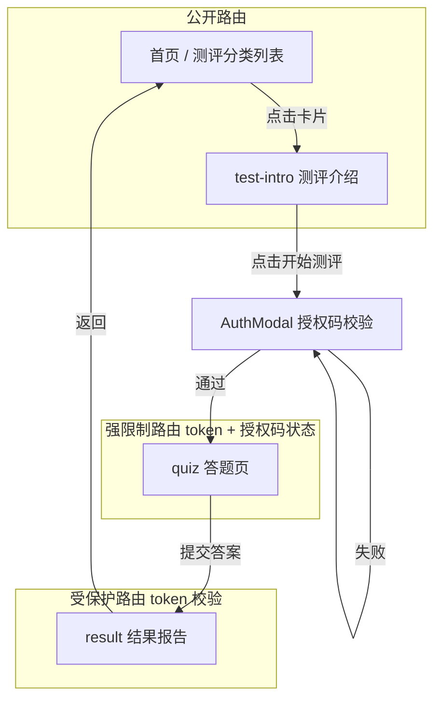

# 趣味测评 SPA 前端项目实施计划

## 一、项目概述

公开对外使用的趣味测评单页应用（SPA），技术栈为 **React 18 + Vite + React-Router v6 + Axios**。

### 业务规则
1. 首页直接展示测评分类列表，**无需授权码**即可浏览
2. 点击测评卡片进入介绍页（公开、独立沉浸式展示页）
3. 介绍页点击【开始测评】后，弹出授权码输入框，调用后端校验；**输入授权码不消耗授权码**
4. 只有提交答题完成后，授权码才会被后端标记为已使用
5. token 有效期内：可以反复查看测评报告；但授权码已使用后，**禁止进入答题页面**
6. 路由分为公开路由、受保护路由、强限制答题路由

### 技术栈
- React 18，Vite 构建，**不使用 create-react-app**
- react-router-dom v6 做路由管理
- axios 统一请求后端 api
- 本地存储：localStorage 保存 sessionToken
- UI：简洁清新，绿色顶部栏、卡片按钮样式；移动端响应式适配
- 不使用 UI 组件库，手写 css，保证轻量
- 开发环境配置 vite 代理 `/api` 转发到后端 `127.0.0.1:5000`

---

## 二、项目目录结构

```
heart-test/
├── index.html                     # Vite 入口 HTML
├── package.json                   # 依赖与脚本
├── vite.config.js                 # Vite 配置 + /api 代理到 127.0.0.1:5000
├── .gitignore                     # 忽略 node_modules、dist 等
├── public/                        # 静态资源（favicon 等）
└── src/
    ├── main.jsx                   # 入口：挂载 BrowserRouter + App
    ├── App.jsx                    # 根组件：定义路由表
    ├── api/
    │   └── api.js                 # axios 封装：拦截器、token 注入、401 处理
    ├── components/
    │   ├── Layout.jsx             # 全局布局：顶部导航栏 + 底部免责文案（首页/列表/报告页使用）
    │   ├── AuthGuard.jsx          # 路由守卫：token 校验 + /quiz 强限制校验
    │   ├── HomePage.jsx           # 首页：测评分类列表（公开）
    │   ├── TestIntro.jsx          # 测评介绍页（公开、独立沉浸式，无导航栏/免责声明）
    │   ├── AuthModal.jsx          # 授权码模态框：输入授权码并校验
    │   ├── QuizPage.jsx           # 答题页
    │   └── ReportPage.jsx         # 结果报告页
    └── styles/
        └── global.css             # 全局样式：绿色顶栏、卡片、响应式
```

### 设计决策
1. **首页即测评列表**：首页 `/` 直接展示测评分类列表，无需授权码即可浏览，降低使用门槛。
2. **介绍页独立沉浸式**：`/test/:testId` 为独立展示页，不套用 Layout（无顶部导航栏和底部免责声明），聚焦测评介绍。
3. **授权码模态框**：点击【开始测评】后弹出 `AuthModal`，输入授权码调用 `verify-code` 校验，通过后保存 token 进入答题页。
4. **api.js 单一封装**：所有接口调用集中在 `src/api/api.js`，页面组件只调用封装的函数。
5. **AuthGuard 双模式**：通过 `requireAuthStatus` prop 区分普通受保护路由与 `/quiz` 强限制路由。
6. **401 全局处理**：在 axios 响应拦截器统一处理，清除 localStorage 并跳转首页。

---

## 三、路由规划

### 路由与守卫关系图



### 路由表

| 路由 | 页面 | 类型 | 守卫要求 |
|------|------|------|----------|
| `/` | 首页（测评分类列表） | 公开 | 无 |
| `/test/:testId` | 测评介绍页 | 公开 | 无（点击开始测评时校验授权码） |
| `/quiz/:testId` | 答题页 | 强限制 | token + 授权码未使用 |
| `/result/:testId` | 结果报告页 | 受保护 | 仅 token 存在 |

### 路由守卫逻辑（前端）
1. 全局路由鉴权高阶组件/路由保护
2. 没有 localStorage 中的 token：受保护路由（报告页）自动重定向到首页 `/`
3. 访问 `/quiz/:testId` 答题页：
   - 前端携带 token 请求后端接口校验当前授权码状态
   - 如果后端返回授权码已使用，拦截页面，提示信息，跳转到首页/测评列表
4. 报告页 `/result/:testId`：只校验 token 存在，不校验授权码状态

---

## 四、接口约定（前端调用，后端实现）

所有请求统一 baseURL 为 `/api`，请求头携带 `Authorization: Bearer {token}`

| 方法 | 路径 | 入参 | 返回 |
|------|------|------|------|
| POST | `/api/verify-code` | `{ authCode: string }` | 成功 `{success:true, token:"xxx"}`；失败 `{success:false, msg:"错误信息"}` |
| GET | `/api/tests` | 无 | 全部测评列表（分类、testId、名称、简介） |
| GET | `/api/test/:testId` | 路径参数 | 单个测评介绍信息 |
| GET | `/api/quiz/:testId` | 路径参数 | 该测评的题目列表 |
| POST | `/api/submit-answer` | `{testId:string, answers:[]}` | 测评报告数据 |
| GET | `/api/get-report/:testId` | 路径参数 | 历史测评报告 |
| GET | `/api/check-auth-status` | 无 | 校验当前 token 对应的授权码状态（用于答题页拦截） |

---

## 五、组件拆分

| 组件 | 文件 | 职责 |
|------|------|------|
| Layout | `Layout.jsx` | 全局布局：顶部导航栏、底部免责声明（首页/报告页使用） |
| AuthGuard | `AuthGuard.jsx` | 路由守卫组件，处理鉴权跳转 |
| HomePage | `HomePage.jsx` | 首页：测评分类列表（公开） |
| TestIntro | `TestIntro.jsx` | 测评介绍页（公开、独立沉浸式） |
| AuthModal | `AuthModal.jsx` | 授权码模态框：输入授权码并校验 |
| QuizPage | `QuizPage.jsx` | 答题页面组件 |
| ReportPage | `ReportPage.jsx` | 结果报告页面组件 |
| api.js | `api.js` | 封装 axios 请求拦截器，统一处理 token、401 未授权 |

---

## 六、全局样式与要求

1. 顶部绿色通栏，放置免责文字
2. 页面整体白底，卡片按钮圆角样式
3. 响应式，手机端适配
4. 错误提示、加载状态、loading 占位
5. 所有接口请求增加 loading 状态，防止重复点击
6. token 过期时，清除 localStorage，跳转首页

---

## 七、实施步骤（Todo 清单）

1. 更新计划文档，反映新流程
2. 修改首页组件：由授权码输入改为测评分类列表展示（公开，保留导航栏和免责文案）
3. 修改测评介绍页：独立沉浸式展示页（无导航栏/免责声明），点击【开始测评】弹出授权码模态框验证
4. 新增 AuthModal 授权码模态框组件：输入授权码，调用 verify-code 验证，通过后保存 token 进入答题页
5. 调整路由守卫：/quiz 强限制路由校验 token + 授权码状态；/result 受保护
6. 调整 App.jsx 路由表：首页公开展示列表，介绍页公开（无 Layout），答题页强限制，报告页受保护
7. 验证项目可运行

---

## 八、注意事项

1. 前端**不存储授权码、题库、报告原始数据**，全部由后端接口返回
2. 授权码状态校验逻辑**不能只在前端做**，前端仅做拦截提示，真实校验必须由后端接口完成，防止绕过前端防护
3. 前端只做展示，业务安全逻辑全部交给后端
